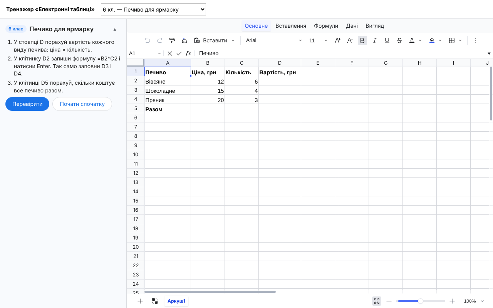

<h1 align="center">edu-sheets</h1>

<p align="center">
  <b>A Google Sheets-style spreadsheet trainer with self-checking tasks and server-side grading.</b><br>
  Formulas, fill handle, formatting, sorting and filters, built on <a href="https://github.com/dream-num/univer">Univer</a>. Made for computer science lessons in grades 6–9.
</p>

<p align="center">
  <a href="https://github.com/zavada123/edu-sheets/actions/workflows/pages.yml"></a>
  <a href="https://zavada123.github.io/edu-sheets/"></a>
  <a href="LICENSE"></a>
  
  
  
</p>

<p align="center">
  <a href="https://zavada123.github.io/edu-sheets/"><b>Live demo</b></a> ·
  <a href="https://github.com/zavada123/edu-sheets/actions/workflows/pages.yml"><b>CI &amp; deploys</b></a> ·
  <a href="#installation">Installation</a> ·
  <a href="#usage">Usage</a> ·
  <a href="#api">API</a>
</p>

<p align="center">
  <a href="https://zavada123.github.io/edu-sheets/"></a>
</p>

## Why

Students learn spreadsheets by entering data, writing formulas and formatting tables, but checking that work by hand is slow, and a finished number does not show whether a formula was used. `edu-sheets` gives every student a familiar spreadsheet in the browser, describes the task declaratively and checks the result, including whether formulas really recalculate with different data.

The spreadsheet is rendered by [Univer](https://github.com/dream-num/univer) (Apache-2.0). This package adds tasks, check conditions, server-side grading, a Ukrainian interface and Ukrainian formula notation. It was built for [EduProstir](https://eduprostir.com), a Ukrainian learning platform.

## Features

- **Looks and behaves like Google Sheets:** formula bar, name box, ribbon tabs (Home, Insert, Formulas, Data, View), sheet tabs and a status bar with sum and average.
- **Real formulas:** addresses, ranges, `$` references and hundreds of functions (SUM, AVERAGE, MIN, MAX, COUNT, IF, AND, OR, ROUND…). Errors `#DIV/0!`, `#NAME?`, `#VALUE!` and `-5^2 = 25`, as in Excel.
- **Ukrainian notation, as in the textbooks:** `2,5` is a number and `=IF(B2>=8000;"так";"ні")` is a formula. The trainer converts the input to what the engine reads (`2.5`, `,`).
- **Fill handle:** number series and formula copying with shifted references.
- **Formatting:** font, bold, italic, text and fill colour, borders, alignment, wrapping, merging, number formats, column widths.
- **Data tools:** multi-level sorting, filters and conditional formatting.
- **Ukrainian UI** with the same terms as Ukrainian Excel.
- **Works on desktops, tablets and phones.**
- **Tamper-proof grading:** the server recalculates every formula with the same Univer engine instead of trusting values from the page.

## Installation

Install straight from GitHub and pin a commit. The built package is committed in `lib/`, so nothing is compiled on install.

```bash
npm install github:zavada123/edu-sheets#<commit>
```

Univer is installed with the package as a dependency (versions are pinned). Peer dependencies: `react` and `react-dom` 19 or newer.

> The UI entry point is heavy (about 1.8 MB gzipped), so load it lazily with `React.lazy`.

## Usage

### Describe a task

A task is a `Scenario`: what is in the table at the start, and which conditions to check at the end. No code is needed.

```ts
import type { Scenario } from "edu-sheets/core"

const fair: Scenario = {
  id: "g6-fair-cookies",
  grade: 6,
  title: "Печиво для ярмарку",
  task: ["У D2:D4 порахуй вартість: ціна × кількість.", "У D5 порахуй загальну вартість."],
  start: [
    {
      // A cell is a value, or a value with a style. A string starting with = is a formula.
      cells: { A1: { input: "Печиво", style: { bold: true } }, B1: "Ціна", C1: "Кількість", A2: "Вівсяне", B2: 12, C2: 6 },
      widths: { A: 120 }
    }
  ],
  goals: [
    { type: "formula", cells: "D2:D4" },
    { type: "value", cells: "D2:D4", equals: [72, 60, 60] },
    { type: "recalc", cells: "D2", set: { B2: 10 }, equals: 60 }
  ]
}
```

### Render the trainer

```tsx
import { EduSheets } from "edu-sheets/react"
import "edu-sheets/style.css"

<EduSheets
  key={scenario.id}
  scenario={scenario}
  onChange={(workbook) => saveAnswer(workbook)} // the whole table after every change
  onCheck={(solved) => console.log(solved)}
  selfCheck={true}                              // false hides «Перевірити» when your server grades
/>
```

### Grade on the server

Runs in Node, without a browser:

```ts
import { grade } from "edu-sheets/core"

const result = await grade(scenario, answer) // answer is what onChange returned
// { status: "checked", solved: true, results: [...] } or { status: "invalid" }
```

The server computes every formula itself with the same Univer engine, so it never trusts values from the page. An answer larger than `LIMITS` (10 sheets, 5,000 cells) is rejected.

## API

| Entry point | Contents |
|---|---|
| `edu-sheets/react` | The `EduSheets` component |
| `edu-sheets/core` | Workbook model, `compute`, goals (`checkGoals`, `describeGoal`), `grade`, `LIMITS` and the built-in `scenarios`. No React and no page, safe for Node |
| `edu-sheets/style.css` | Styles for the component |

### `<EduSheets>` props

| Prop | Type | Description |
|---|---|---|
| `scenario` | `Scenario` | The task. To show another one, change the component `key` |
| `onCheck` | `(solved: boolean) => void` | Called after every check |
| `onChange` | `(workbook: WorkbookState) => void` | The whole table, every time the student changes it |
| `initialWorkbook` | `WorkbookState` | A previously saved table: the trainer starts from it instead of the scenario start |
| `selfCheck` | `boolean` | `false` hides the Check button when your site grades the answer. Default `true` |

### Goals

Values are the computed ones: a formula counts by its result. Every goal has default student-facing text and a hint, which you can override with `text` and `hint`. `sheet` picks a sheet by name.

| `type` | Checks that |
|---|---|
| `value` | The cells hold these values (one for all, or a list) |
| `formula` | The cells hold formulas rather than typed numbers; the formula reads other cells; required functions are used (`functions: ["SUM"]`) |
| `recalc` | Formulas recalculate correctly with other data: the check applies `set` and computes again. This catches `=B5*45` instead of `=B5*$B$1` |
| `style` | The cells are formatted: `bold`, `italic`, `fill`, `color`, `align`, `wrap`, `fontSize`, `format`. `fill: "*"` means any colour |
| `filled` | The cells are not empty |
| `sorted` | The rows of a range are ordered by a column and kept intact (each name stays with its result) |
| `width` | The column is at least `min` pixels wide |
| `sheet` | A sheet with this name exists |

## Development

```bash
npm install
npm run dev        # demo with all tasks
npm test           # core and task tests (reference solutions in src/scenarios/solutions.ts)
npm run build      # type check and build the demo into dist/
npm run build:lib  # build the package into lib/ (commit lib/ with your changes)
```

Project layout:

- `src/core` — table model, headless computation, goals, grading and Ukrainian notation. No React.
- `src/ui` — the `EduSheets` component, the task card, the Univer bridge and the Ukrainian translation (`locale/uk-UA.ts`).
- `src/scenarios` — tasks based on Ryvkind's textbooks (grades 6 and 8) and their reference solutions.

Every push to `main` runs the tests and deploys the demo to GitHub Pages: see the [workflow runs](https://github.com/zavada123/edu-sheets/actions/workflows/pages.yml).

## Roadmap

- Charts (grade 6, § 6.4): not available in open-source Univer; planned separately with Chart.js.
- Decimal comma in display: `2,5` can be typed but is shown as `2.5`. After entry a formula shows `,` between arguments.
- Goals for conditional formatting rules and filters.
- Function tooltips are in English, as in Univer.

## License

[MIT](LICENSE). Univer is licensed under Apache-2.0.
